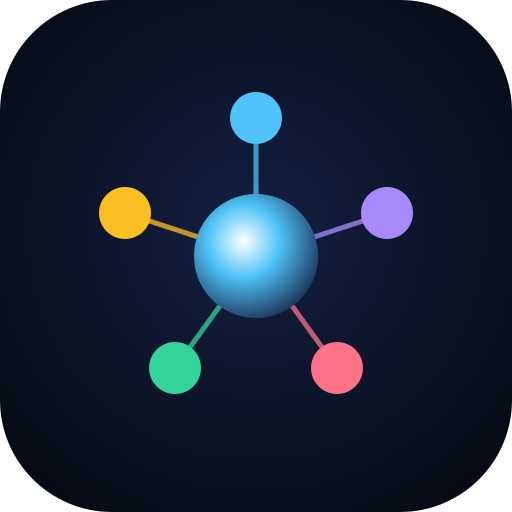

<div align="center">



# OOP Neural Knowledge Graph

**Nesne Yönelimli Programlama kavramlarını fizik tabanlı, interaktif bir nöral ağ haritasında keşfet.**

[**🚀 Canlı Demo**](https://efekocal.github.io/oop-neural-graph/)


</div>

---

Üniversite OOP müfredatındaki kavramları (sınıflar ve nesnelerden istisna yönetimine, olay güdümlü programlamadan tasarım desenlerine) tek bir zihin haritasında toplar. Her düğüme tıkladığında tanımı, **Java** ve **Vanilla JS** kod örneklerini, sınavlarda sık düşülen **tuzakları** ve kendini sınayabileceğin **mini görevleri** görürsün.

Hiçbir framework veya kütüphane kullanılmadı: yalnızca HTML, CSS ve modern JavaScript.

## ✨ Özellikler

| | |
|---|---|
| 🧠 **Önkoşul ağı (DAG)** | 6 kategori, 55 kavram, 64 önkoşul bağı. Kavramlar dersin resmî akışına göre (Sınıf/Nesne → Kalıtım → İstisnalar → Soyut Sınıf/Arayüz → Olaylar → JavaFX → Özyineleme → Generics → Tasarım Desenleri) soldan sağa dizilir; her ok "önce bunu öğren" demektir. Yay fiziğiyle süzülen düğümler, sürükle-bırak, kaydırma, yakınlaştırma. |
| 🛰️ **Uydu alt konular** | Ders slaytlarındaki 124 ayrıntı (ör. *this(...) zinciri*, *JRadioButton + ButtonGroup*, *Sudoku*, *BounceBall*) ana kavramın etrafında küçük aylar olarak döner; kavram seçilince ya da üzerine gelinince halka hâlinde açılır. Her biri tanım, ders kodu ve çoğunda görev/tuzak içerir. |
| 🎓 **Müfredat Modu** | Topolojik sıralamayla önkoşulları tamamlanmış "sıradaki" kavramları bulur; yalnızca onları ve oraya giden yolu parlatır, kamerayı hedefe götürür. Kilit yok: istediğin an Serbest Dolaşım'a geçebilirsin. |
| ✅ **İlerleme** | "Bunu Öğrendim" ile işaretlenen kavramlar yeşile döner, çıkan bağlarında sinyal hızlanır; yeni açılan kavramlar bildirilir. Tamamlanma oranı üstteki çubukta. |
| 💻 **Çift dilli kod** | Her kavram için Java ve Vanilla JS (ES6 class) örneği; VS Code temalı görünüm, sözdizimi vurgulama ve kritik satırın parlatılması. |
| ⌨️ **Akıllı Ev Pratiği** | 13 bölümlük kodlama laboratuvarı: Device → Light → Thermostat hikâyesi sınıflardan arayüzlere kadar adım adım büyür. Kod tarayıcıda yazılır ve metin kurallarıyla anında denetlenir; geçilen bölüm grafta "öğrenildi" olur. |
| 🎯 **Görevler** | 70 mini sınav. 8'i iki aşamalı *Derleme Tarayıcısı*: önce "Bu kod derlenir mi?", sonra "Çıktısı ne olur?" İlerleme tarayıcıda saklanır. |
| 🚨 **Tuzaklar ve ipuçları** | Başlatma sırası, `finally` içindeki `return`, overload seçim önceliği gibi sınavlarda puan kaybettiren ince noktalar. |
| 🔎 **Anlık arama** | Türkçe karakterlere duyarsız (`kalitim` → *Kalıtım*). Eşleşen düğümler ve kökten onlara giden yol parlar, gerisi soluklaşır. |
| 📱 **PWA** | Çevrimdışı çalışır; masaüstüne veya telefona uygulama olarak yüklenebilir. |
| ♿ **Erişilebilirlik** | Klavye ile tam kullanım, ekran okuyucu için kavram listesi, `prefers-reduced-motion` desteği. |

### Klavye kısayolları

| Tuş | İşlev |
|---|---|
| <kbd>/</kbd> veya <kbd>Ctrl</kbd>+<kbd>K</kbd> | Aramaya odaklan |
| <kbd>Enter</kbd> | Aramadaki en iyi sonucu aç |
| <kbd>←</kbd> <kbd>→</kbd> | Aynı kategorideki önceki / sonraki kavram |
| <kbd>Esc</kbd> | Aramayı temizle / paneli kapat |

## 📚 İçerik

| Kategori | Kavramlar |
|---|---|
| **Core OOP** | Nesneler, Sınıflar, UML Sınıf Diyagramı, Yapıcılar, İlkel vs Nesne Türleri, Çöp Toplama, Kapsülleme, `this`, Referans Veri Alanları, `null`, Görünürlük Belirleyiciler, `static`, Çok Boyutlu Diziler, `ArrayList` |
| **Advanced OOP** | Kalıtım, Süper/Alt Sınıflar, `super`, Overriding, Overloading, Polymorphism, Dinamik Bağlama, Casting, `instanceof`, `Object` (toString/equals), Soyut Sınıflar, Arayüzler, Özyineleme, Generics |
| **İstisna Yönetimi** | `Throwable`, `Error`, `Exception`, try-catch-finally, `throws`, `throw`, Zincirleme İstisna, Özel İstisnalar |
| **Event-Driven** | Olaylar, Dinleyiciler, İç Sınıflar, Anonim Sınıflar, Lambda, Fare/Klavye Olayları, `Timer` |
| **GUI & I/O** | `File`, `PrintWriter`, `Scanner`, Swing, Swing Bileşenleri, JavaFX (Stage/Scene), Layout Panelleri, Şekiller, JavaFX Animasyonları |

Alt konular, dersin BP-II slaytlarını (Liang, *Introduction to Java Programming*) bölüm bölüm kapsar: Sınıf/Nesne + ArrayList, Kalıtım/Çok Biçimlilik, İstisnalar/Metin G/Ç, Soyut Sınıf/Arayüz, Olay Güdümlü Programlama (Swing + JavaFX), Swing Bileşenleri, JavaFX Temelleri ve Animasyonlar, Çok Boyutlu Diziler.
| **Tasarım Desenleri** | Singleton, Factory Method, Adapter |

## 🚀 Yerelde çalıştırma

Derleme adımı ve bağımlılık yoktur. Herhangi bir statik sunucu yeterlidir:

```bash
npx serve .
# veya
python -m http.server 8000
```

> `index.html` dosyasını doğrudan açmak da çalışır; ancak çevrimdışı mod (Service Worker) yalnızca `http(s)` üzerinden açıldığında devreye girer.

## 🗂️ Proje yapısı

```
├── index.html          # Uygulama kabuğu (canvas, panel, arama)
├── style.css           # Dark tema, panel, VS Code editörü, animasyonlar
├── manifest.json       # PWA manifesti
├── sw.js               # Service Worker (çevrimdışı önbellek)
├── icons/              # Uygulama ikonları (SVG + PNG)
└── js/
    ├── data.js         # Kavramlar, JS örnekleri, görevler, tuzaklar, pratikler
    ├── subtopics.js    # Uydu alt konular (slayt ayrıntıları, ders kodları, görevler)
    ├── highlight.js    # Java / JS sözdizimi vurgulayıcı
    ├── physics.js      # DAG modeli, şeritli yerleşim, yay fizik motoru
    ├── curriculum.js   # İlerleme, topolojik sıra, Müfredat Modu hedefleri
    ├── renderer.js     # Kamera, Canvas çizimi, parçacık efektleri
    ├── panel.js        # Bilgi paneli: kod sekmeleri, görevler, pratik editörü
    ├── search.js       # Arama ve filtreleme
    └── main.js         # Uygulama denetleyicisi, giriş olayları, döngü
```

## 🧩 Mimari

```
data.js ──► buildGraph ──► PhysicsEngine ──► GraphRenderer + Effects ──► <canvas>
                │                                    ▲
                ├──► GraphSearch ────────────────────┤  (main.js her karede
                └──► InfoPanel ◄──── seçim ──────────┘   durumu birleştirir)
```

- **Topoloji:** `dependsOn` ilişkilerinden Yönlü Döngüsüz Graf kurulur; Kahn algoritmasıyla topolojik sıra ve derinlik (en uzun önkoşul zinciri) hesaplanır, döngü varsa konsolda uyarılır. Sütun = derinlik, şerit = kategori.
- **Fizik:** Her düğüm, yerleşim noktasına bir yayla bağlıdır ve bu nokta yavaş sinüs dalgalarıyla salınır (ipe bağlı balon etkisi). Önkoşul bağları da yaydır (anchor'dan zayıf tutulur, böylece çok bağlı ağda dolanma olmaz); yakın düğümler birbirini iter. Entegrasyon 120 Hz sabit alt adımlı yarı-örtük Euler ile yapılır, bu yüzden kare hızı dalgalansa da sistem kararlıdır.
- **Çizim:** Glow efekti için pahalı `shadowBlur` yerine additive (`lighter`) karışım ve iki geçişli çizgiler kullanılır.
- **Modüller:** Klasik `<script>` dosyaları sırayla yüklenir; bu sayede proje sunucu olmadan da çalışır.

## ✍️ İçerik ekleme

Ana içerik [`js/data.js`](js/data.js), alt konular [`js/subtopics.js`](js/subtopics.js) dosyasındadır:

| Ne eklenecek | Nereye |
|---|---|
| Yeni kavram | `KNOWLEDGE.categories[].concepts` — `{ id, title, def, code }` |
| JS örneği | `JS_EXAMPLES` — anahtar: kavram `id` |
| Görev | `QUIZZES` — tek aşamalı veya `stages` ile çok aşamalı |
| Tuzak | `TRAPS` — `[{ title, text }]` |
| Önkoşul | `DEPENDENCIES` — `id: ["önkoşul-id", ...]` |
| Alt konu (uydu) | `js/subtopics.js` → `SUBTOPICS` — anahtar: ana kavram `id`, değer: `[{ id, title, label?, def, code?, quiz?, traps? }]` |
| Pratik | `PRACTICES` — `{ instruction, skeleton, validationKeys, successMessage }` (taslak kod kuralları geçmemeli) |

Kod örneklerinde satır sonuna `//!` yazarsan o satır panel açılınca parlatılır.

> **Yayınlamadan önce:** `sw.js` içindeki `CACHE_VERSION` değerini artır; aksi hâlde daha önce siteyi açmış kullanıcılar eski sürümü görebilir.

## 🌐 Yayınlama

`main` dalına yapılan her push, [GitHub Actions](.github/workflows/pages.yml) ile otomatik olarak GitHub Pages'e yayınlanır.

## 📄 Lisans

[MIT](LICENSE)
